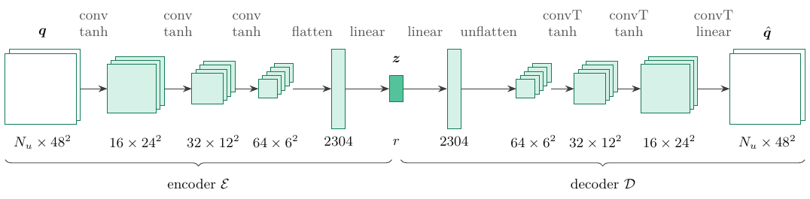
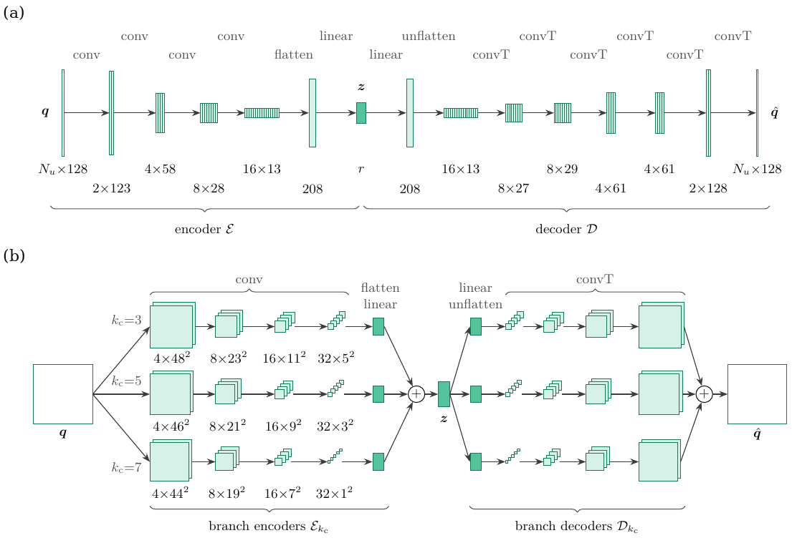

# Convolutional autoencoders

A convolutional autoencoder is a nonlinear projector: an encoder network maps a flow snapshot on
its grid to a few reduced coordinates, and a decoder network maps them back to the flow field.
In romda, it plays the role that proper orthogonal decomposition (POD) plays in a linear
reduced-order model: an echo state network (ESN) forecasts the reduced coordinates, and the
decoder maps the forecast, or the data assimilation (DA) analysis, back to the flow field
([Latent reduced-order models](models_data_driven_latent_roms.md)). This page documents the
networks, their options, their training, and how a trained network is saved and restored.

The networks are written in PyTorch, which is the optional extra `torch`:

```bash
pip install "romda[torch]"            # from PyPI
pip install -e ".[torch]" --use-pep517  # from a source checkout
```

Importing `romda` or `romda.models.data_driven` does not import torch; the classes below load it
the first time they are accessed.

| Class | File | What it is |
|---|---|---|
| `Projector` | `autoencoders/base.py` | Interface shared with `POD` and `SPOD`: `fit`, `encode`, `decode` |
| `Autoencoder` | `autoencoders/autoencoder_base.py` | Training options, preprocessing, save and restore of every autoencoder |
| `TorchAutoencoder` | `autoencoders/torch_utils.py` | PyTorch training loop and differentiable `encode_torch` / `decode_torch` |
| `CAE` | `autoencoders/cae.py` | Convolutional autoencoder on the snapshot grid, with configurable stages |
| `CAE1D`, `MultiScaleCAE` | `autoencoders/cae_esn.py` | The autoencoders of the convolutional autoencoder echo state network (CAE-ESN) papers |

`Autoencoder`, `TorchAutoencoder`, `CAE`, `Configurable`, `TrainingHistory` and `model_config`
are ported from autoencoder-rom, written by Lukas Campbell (2026, MIT licence), and the
`Projector` interface merges romda's original projector base with the generalization in
autoencoder-rom.

## Notation and preprocessing

A snapshot $\vect{q} \in \mathbb{R}^{N_x}$ holds the $N_u$ field components at the fluid
points, grouped by component. A grid record has shape $(N_u, N_t, n_x, n_y)$, in which $N_t$
is the number of snapshots and $n_x \times n_y$ is the grid, with NaN at solid points; a
one-dimensional field is a grid $(N_u, N_t, n_x, 1)$. Before training, every autoencoder centres
and scales the snapshots,

$$
\tilde{\vect{q}} = \mathrm{diag}(\vect{\sigma}_q)^{-1}\,(\vect{q} - \bar{\vect{q}}),
\qquad
\vect{z} = \mathcal{E}(\tilde{\vect{q}}) \in \mathbb{R}^{r},
\qquad
\hat{\vect{q}} = \vect{\sigma}_q \odot \mathcal{D}(\vect{z}) + \bar{\vect{q}},
$$

where $\bar{\vect{q}}$ is the temporal mean of the training snapshots (`Q_mean`); $\vect{\sigma}_q$
holds, for each component, the standard deviation of that component over all fluid points and
training snapshots (`scale`; a component with zero variance gets 1, and a flat record counts as
one component); $\mathcal{E}$ and $\mathcal{D}$ are the encoder and decoder; $\vect{z}$ holds the
reduced coordinates (called latent variables in machine learning), with $r$ = `n_latent`;
$\hat{\vect{q}}$ is the reconstruction; and $\odot$ is the element-wise product. With
`scale_fields=False`, $\vect{\sigma}_q = \vect{1}$ and the loss is the reconstruction error of the
zero-mean fields themselves. $\bar{\vect{q}}$ and $\vect{\sigma}_q$ come from the training snapshots
only, never from the validation block. `CAE1D` and `MultiScaleCAE` scale differently
([below](#cae-esn-autoencoders-cae1d-and-multiscalecae)). Below, $\tilde{\vect{q}}$ is written
$\vect{q}$, a batch of $B$ snapshots is $\matr{Q}$ and its reduced coordinates are
$\matr{Z} \in \mathbb{R}^{r \times B}$, one snapshot per column (the code stores rows).

## Projector interface

Every projector, linear or nonlinear, follows the interface of `Projector`:

| Method | Returns |
|---|---|
| `fit(X)` | The fitted projector. `X` is a grid record $(N_u, N_t, n_x, n_y)$ with NaN at solid points |
| `encode(X)` | Reduced coordinates, shape $(r, N_t)$ |
| `decode(Z)` | Flat fields with the mean restored, shape $(N_x, N_t)$ |
| `reconstruct(X)`, `score(X)` | The round trip `decode(encode(X))` and its mean squared error |
| `decode_at(Z, idx)` | The decoded rows `idx` only, e.g. at sensor locations |
| `spatial_basis(z0)` | The decoder Jacobian at `z0` (the origin by default) by central differences, the local analogue of the POD modes |

`TorchAutoencoder` adds the differentiable maps that gradient-based methods need:
`encode_torch(T)` maps a batch of scaled snapshots, on the grid with zeros at solid points, to
$\matr{Z}$, `decode_torch(Z)` maps $\matr{Z}$ to the scaled flat fields $(B, N_x)$, and
`decoder_networks()` lists the networks that `decode_torch` applies. `encode` and `decode`
wrap these maps in NumPy. The options `device` (default `"cpu"`; e.g. `"cuda"` or `"mps"`) and
`compile` (default `False`, `torch.compile` on the training loss) control where and how the
networks run.

::: romda.models.data_driven.autoencoders.autoencoder_base.Autoencoder

::: romda.models.data_driven.autoencoders.torch_utils.TorchAutoencoder

## Convolutional autoencoder, `CAE`

The encoder of `CAE` applies one two-dimensional convolution per entry of `channels`, default
`(16, 32, 64)`, each followed by `activation` (`"tanh"` by default; `"relu"`, `"elu"`, `"gelu"`
or `"identity"`), then flattens the result and maps it linearly to $r$ reduced coordinates. The
decoder maps $\vect{z}$ linearly back to the bottleneck grid and applies the mirrored transposed
convolutions; the last one is linear. The encoder reads the scaled snapshot $\vect{q}$ arranged
on the $n_x \times n_y$ grid, with one channel per field component and zeros at the solid
points, and the decoder returns the reconstruction $\hat{\vect{q}}$ on the same grid, from which
the fluid points are read. `CAE` needs a grid record. An axis of length 1 is not convolved, so
`CAE` also reduces a one-dimensional field $(N_u, N_t, n_x, 1)$. The architecture follows Masci
et al. (2011), and Murata et al. (2020) applied convolutional autoencoders of this kind to fluid
flows.

```python
from romda.models.data_driven import CAE

cae = CAE(n_latent=8, channels=(16, 32, 64)).fit(X)   # X: grid record (N_u, N_t, n_x, n_y)
Z = cae.encode(X)                                       # (8, N_t)
X_hat = cae.decode(Z)                                   # (N_x, N_t)
```

All convolutions share `kernel_size` $k_\mathrm{c}$ (default 3) and `pad` $p_\mathrm{c}$
(default 1); `stride` $s_\mathrm{c}$ (default 2) is one value or one per entry of `channels`.
`conv_stages` computes the grid sizes; along each axis, a convolution maps $n$ points to

$$
n' = \left\lfloor \frac{n + 2p_\mathrm{c} - k_\mathrm{c}}{s_\mathrm{c}} \right\rfloor + 1 ,
$$

and the matching transposed convolution restores $n$ with the output padding

$$
o = n - \big[(n' - 1)s_\mathrm{c} - 2p_\mathrm{c} + k_\mathrm{c}\big] \in \{0, \dots, s_\mathrm{c}-1\},
$$

[Dumoulin & Visin 2016]. For example, the defaults reduce a $48 \times 48$ grid to
$24 \times 24$, $12 \times 12$ and $6 \times 6$, with $o = 1$ in every transposed convolution.
`conv_stages` raises `ValueError` if a stage input is smaller than the padded kernel; fewer
entries in `channels` then fix it. Solid points enter the network as zeros and are left out of
the loss,

$$
\mathcal{L}_\mathrm{CAE} = \frac{1}{B\,N_u\,N_\mathrm{fl}} \sum_{b=1}^{B} \sum_{i=1}^{N_u}
\sum_{j} m_j \big(\hat{q}_{bij} - q_{bij}\big)^2 ,
$$

where $q_{bij}$ is the scaled component $i$ of snapshot $b$ at grid point $j$, $\hat{q}_{bij}$ its
reconstruction, $m_j$ is 1 at fluid points and 0 at solid points, and $N_\mathrm{fl}$ is the number of
fluid points. The training and validation losses are both $\mathcal{L}_\mathrm{CAE}$.



*The convolutional autoencoder with the default `channels=(16, 32, 64)`, kernel 3, stride 2 and padding 1 on a $48 \times 48$ grid: three convolutions halve the grid to $6 \times 6$, a linear map gives the reduced coordinates, and the mirrored transposed convolutions with output padding 1 restore the grid.*

### Architecture options

The options below change the stages of `CAE`; the defaults give the network of the figure.

| Option | Default | Effect |
|---|---|---|
| `channels` | `(16, 32, 64)` | Output channels of each encoder convolution; the decoder mirrors them |
| `kernel_size`, `pad` | `3`, `1` | Kernel size and padding of every convolution |
| `stride` | `2` | Stride of every stage, or one per stage. A stride-1 stage keeps its grid: `stride=(1, 2, 2)` convolves the field at full resolution before halving it twice, and the decoder ends with a convolution at full resolution |
| `periodic_padding` | `False` | Pads circularly instead of with zeros, for a field periodic along both axes (e.g. the Kolmogorov flow) or along the one axis of a grid $(n_x, 1)$ (e.g. the Kuramoto–Sivashinsky equation). The decoder applies `PeriodicConvTranspose2d`, and every encoder stage must divide its grid exactly by its stride |
| `decoder_upsampling` | `"transposed"` | How each decoder stage enlarges the grid: `"transposed"`, a strided transposed convolution; `"resize"`, nearest-neighbour upsampling followed by a stride-1 convolution, with the same number of weights |
| `hidden` | `()` | Widths of dense layers between the flattened bottleneck grid and $\vect{z}$, each followed by `activation`, mirrored in the decoder; empty gives one linear map each way |
| `latent_channels` | `0` | Channels of a convolutional bottleneck: the reduced coordinates are `latent_channels` channels on the bottleneck grid, reached by a linear $1 \times 1$ convolution, so `n_latent` becomes `latent_channels` times the number of bottleneck points. Excludes `hidden` |

Zero padding imposes a wall at the edge of the grid, whereas periodic padding keeps the
translation symmetry of a periodic domain. A transposed convolution whose kernel is not a multiple
of its stride overlaps unevenly and leaves grid-scale checkerboard artefacts in the
reconstruction; `decoder_upsampling="resize"` avoids them (Odena, Dumoulin & Olah 2016).

::: romda.models.data_driven.autoencoders.cae.CAE

::: romda.models.data_driven.autoencoders.autoencoder_base.conv_stages

## CAE-ESN autoencoders, `CAE1D` and `MultiScaleCAE`

`CAE1D` and `MultiScaleCAE` reproduce the autoencoders of the CAE-ESN of Racca et al. (2023) and
Özalp et al. (2026), layer by layer, from the PyTorch code that accompanies the second paper
([MagriLab/DA-CAE-ESN](https://github.com/MagriLab/DA-CAE-ESN)). The layer names match that
code, so its trained weights load with `load_state_dicts(state, grid_shape, scale)`. The
architecture is fixed by the papers, so the `CAE` options `kernel_size`, `stride`, `pad`,
`hidden` and `latent_channels` are unused; `MultiScaleCAE` keeps `channels` (four entries) and
adds `kernel_sizes`. Both networks differ from `CAE` in their preprocessing: every stage,
including the encoder output and the decoder output, is followed by `activation` (tanh by
default, as in the papers), except the stride-2 transposed convolutions of the `CAE1D` decoder,
each of which feeds a stride-1 transposed convolution of kernel 3 directly, with tanh after the
pair. For this reason, the temporal mean is not removed ($\bar{\vect{q}} = \vect{0}$) and every point
is divided by the maximum absolute value of the training fields, $\vect{\sigma}_q = \max_{t,j} |q_{j,t}|\,\vect{1}$.
With tanh, each branch gives reduced coordinates in $(-1, 1)$, and the $N_\mathrm{br}$ summed branches of
`MultiScaleCAE` give coordinates in $(-N_\mathrm{br}, N_\mathrm{br})$.

| | `CAE1D` | `MultiScaleCAE` |
|---|---|---|
| Field | One-dimensional, grid $(N_u, N_t, n_x, 1)$, e.g. Kuramoto–Sivashinsky | Two-dimensional, e.g. vorticity of the Kolmogorov flow |
| Encoder | Conv1d with 2, 4, 8, 16 channels; kernels 8, 8, 3, 3; strides 1, 2, 2, 2 | One branch per entry of `kernel_sizes` (default `(3, 5, 7)`): Conv2d with `channels` (default 4, 8, 16, 32); strides 1, 2, 2, 2 |
| Decoder | Three stride-2 transposed convolutions (kernels 3, 5, 8), each followed by a kernel-3 stride-1 one | Per branch: three stride-2 transposed convolutions, then one of kernel $k_\mathrm{c}+1$ and padding 1 |
| Grids restored | Some $n_x$ only, e.g. 96 or 128 | Some sides only, e.g. $48 \times 48$ |
| Padding | Zeros | Zeros; `periodic_padding=True` pads circularly (odd kernels, sides multiples of 8) |
| Initialization | Xavier-normal encoder weights | Kaiming-uniform weights |

`MultiScaleCAE` sums the branches,

$$
\vect{z} = \sum_{k_\mathrm{c}} \mathcal{E}_{k_\mathrm{c}}(\vect{q}), \qquad \hat{\vect{q}} = \sum_{k_\mathrm{c}} \mathcal{D}_{k_\mathrm{c}}(\vect{z}),
$$

where $\mathcal{E}_{k_\mathrm{c}}$ and $\mathcal{D}_{k_\mathrm{c}}$ are the encoder and decoder of the branch with kernel size $k_\mathrm{c}$, and
$\vect{q}$ is the scaled snapshot on the grid. Kernels of different size capture structures
of different scale [Racca et al. 2023]. By default, the convolutions pad with zeros, as the
DA-CAE-ESN code does, so they do not impose the periodicity of the domain. With
`periodic_padding=True`, every convolution of `MultiScaleCAE` pads circularly by
$(k_\mathrm{c} - 1)/2$ and the last layer is a periodic convolution of kernel $k_\mathrm{c}$;
`CAE1D` raises `NotImplementedError` for this option. Both classes raise `ValueError` if the
decoder does not restore the grid size. Use them to reproduce the CAE-ESN results, or as tested
architectures for the Kuramoto–Sivashinsky equation and the Kolmogorov flow.

```python
from romda.models.data_driven import CAE1D, MultiScaleCAE

cae_ks = CAE1D(n_latent=8).fit(U)              # U: Kuramoto–Sivashinsky, shape (1, N_t, 128, 1)
cae_kf = MultiScaleCAE(n_latent=16).fit(W)     # W: vorticity, shape (1, N_t, 48, 48)
```



*The CAE-ESN autoencoders stage by stage: `CAE1D` on 128 points and the three-branch `MultiScaleCAE` on a $48 \times 48$ grid. The labels give the shape (channels $\times$ points) after each stage. Tanh follows every stage, except the stride-2 transposed convolutions of `CAE1D`, each of which feeds a stride-1 transposed convolution directly.*


The tutorials
[45_DA_CAE_ESN_KS.ipynb](../tutorials/4_Real-time_DA_ROMs/45_DA_CAE_ESN_KS.md)
(Kuramoto–Sivashinsky) and
[46_DA_CAE_ESN_Kolmogorov.ipynb](../tutorials/4_Real-time_DA_ROMs/46_DA_CAE_ESN_Kolmogorov.md)
(Kolmogorov flow) train these autoencoders inside a CAE-ESN and assimilate sensor data into it.

::: romda.models.data_driven.autoencoders.cae_esn.CAE1D

::: romda.models.data_driven.autoencoders.cae_esn.MultiScaleCAE

## Training loop

All autoencoders train with `TorchAutoencoder._train`, which minimizes the training loss
with Adam [Kingma & Ba 2015] on shuffled minibatches of `batch_size` snapshots (default 32; the
last batch may be smaller). The option `weight_decay` (default 0) adds
`weight_decay` times $\vect{\theta}$, the gradient of an L2 penalty on the network weights $\vect{\theta}$, to the
loss gradient before the Adam update, as `torch.optim.Adam` does. This coupled L2 regularization
differs from the decoupled weight decay of AdamW [Loshchilov & Hutter 2019]. The validation block is chosen in one of two ways:

- `fit(X)` holds out the last $\mathrm{round}(f_\mathrm{val} N_t)$ snapshots of `X`, with
  $f_\mathrm{val}$ = `val_fraction` (default 0.2); the block is the end of the record, so it is not
  interleaved with the training snapshots.
- `fit(X, X_val=...)` validates on `X_val`, centred and scaled with the training statistics,
  and trains on every snapshot of `X`.

After every epoch, the validation loss $\mathcal{L}_\mathrm{val}$ is computed in one pass over the validation block.
An epoch makes progress if $\mathcal{L}_\mathrm{val} < \mathcal{L}_\mathrm{val}^\ast (1 - \texttt{threshold})$, where $\mathcal{L}_\mathrm{val}^\ast$ is the lowest validation
loss so far and `threshold` defaults to $10^{-4}$. After more than `lr_patience`
(default 10) epochs without progress, the learning rate $\eta$ decays to
$\max(\gamma \eta, \eta_\mathrm{min})$, with $\gamma$ = `lr_factor` (default 0.5) and
$\eta_\mathrm{min}$ = `min_lr` (default $10^{-6}$), as in `ReduceLROnPlateau`. Training stops
after `patience` (default 50) consecutive epochs without progress, or after `epochs` (default
500), and the weights of the last epoch that made progress, i.e. of the lowest validation loss
up to `threshold`, are restored [Prechelt 1998].

Without a validation block (`val_fraction=0` and no `X_val`), training runs the full `epochs`
budget at the constant learning rate `learning_rate` (default $10^{-3}$) and keeps the final
weights. A `val_fraction` that rounds to zero snapshots gives the same behaviour and raises a
`UserWarning`. `training_history` records, per epoch, the mean training loss (`train`), the
validation loss (`val`, empty without validation) and the learning rate (`lr`). With
`warm_start=True`, `fit` continues a fitted autoencoder from its current weights and its last
learning rate; `epochs` then counts the additional epochs and the history grows.

::: romda.models.data_driven.training.TrainingHistory

## Save and restore

Every autoencoder is a `Configurable` dataclass. Its constructor options
(`config_options()`, without `grid_shape`, `device`, `compile` and `warm_start`) and its trained
arrays (`trained_arrays()`: `Q_mean`, `scale`, `grid_shape` for grid records, `fluid_mask_flat`,
the total kinetic energy `TKE`, the training history and the network weights) rebuild it with
`from_trained`. `model_config` stores both on disk:

```text
<store>/<hash>/model_config.yaml       class path and options
<store>/<hash>/trained_matrices.npz    trained arrays
```

where `<store>` defaults to `results/model_configs` (`MODEL_STORE`) and `<hash>` is the first
16 hexadecimal digits of the SHA-256 digest of the class path, the options and the name of the
training data, with floats rounded to 12 decimals.

```python
from romda.models.data_driven import CAE
from romda.models.data_driven.model_config import (
    auto_load_or_create, load_model_from_config, save_model_to_config)

config, path = save_model_to_config(cae, training_data_filename="wake.h5")
cae = load_model_from_config(q=config.to_hash(), device="cuda")
cae = auto_load_or_create(CAE, data=X, training_data_filename="wake.h5", n_latent=8)
```

`auto_load_or_create` loads the saved model whose hash matches the options and
`training_data_filename`, or trains and saves a new one. The hash does not see the data
themselves, so a changed record must come with a new `training_data_filename` (or
`force_create=True`). On restore, options that the class no longer defines are dropped.
`load_model_from_config` takes keyword overrides, such as `device`, that replace the stored
options. `auto_load_or_create` restores a saved model with its stored options only, so its
networks run on the CPU; `load_model_from_config(q=..., device="cuda")` places them on a GPU.
A restored autoencoder enters a CAE-ESN through `projector=`
([Latent reduced-order models](models_data_driven_latent_roms.md#projector-and-forecaster)).

::: romda.models.data_driven.configurable.Configurable

::: romda.models.data_driven.model_config.save_model_to_config

::: romda.models.data_driven.model_config.load_model_from_config

::: romda.models.data_driven.model_config.auto_load_or_create

::: romda.models.data_driven.model_config.list_saved_configs

## References

- Dumoulin, V. & Visin, F. 2016 A guide to convolution arithmetic for deep learning. [arXiv:1603.07285](https://arxiv.org/abs/1603.07285)
- Kingma, D. P. & Ba, J. 2015 Adam: a method for stochastic optimization. In *3rd International Conference on Learning Representations (ICLR)*. [arXiv:1412.6980](https://arxiv.org/abs/1412.6980)
- Loshchilov, I. & Hutter, F. 2019 Decoupled weight decay regularization. In *7th International Conference on Learning Representations (ICLR)*. [arXiv:1711.05101](https://arxiv.org/abs/1711.05101)
- Masci, J., Meier, U., Cireşan, D. & Schmidhuber, J. 2011 Stacked convolutional auto-encoders for hierarchical feature extraction. In *Artificial Neural Networks and Machine Learning – ICANN 2011*, LNCS **6791**, pp. 52–59. Springer. [doi:10.1007/978-3-642-21735-7_7](https://doi.org/10.1007/978-3-642-21735-7_7)
- Murata, T., Fukami, K. & Fukagata, K. 2020 Nonlinear mode decomposition with convolutional neural networks for fluid dynamics. *Journal of Fluid Mechanics* **882**, A13. [doi:10.1017/jfm.2019.822](https://doi.org/10.1017/jfm.2019.822)
- Odena, A., Dumoulin, V. & Olah, C. 2016 Deconvolution and checkerboard artifacts. *Distill*. [doi:10.23915/distill.00003](https://doi.org/10.23915/distill.00003)
- Özalp, E., Nóvoa, A. & Magri, L. 2026 Real-time forecasting of chaotic dynamics from sparse data and autoencoders. *Computer Methods in Applied Mechanics and Engineering* **450**, 118600. [doi:10.1016/j.cma.2025.118600](https://doi.org/10.1016/j.cma.2025.118600)
- Prechelt, L. 1998 Early stopping – but when? In *Neural Networks: Tricks of the Trade* (ed. G. B. Orr & K.-R. Müller), LNCS **1524**, pp. 55–69. Springer. [doi:10.1007/3-540-49430-8_3](https://doi.org/10.1007/3-540-49430-8_3)
- Racca, A., Doan, N. A. K. & Magri, L. 2023 Predicting turbulent dynamics with the convolutional autoencoder echo state network. *Journal of Fluid Mechanics* **975**, A2. [doi:10.1017/jfm.2023.716](https://doi.org/10.1017/jfm.2023.716)
