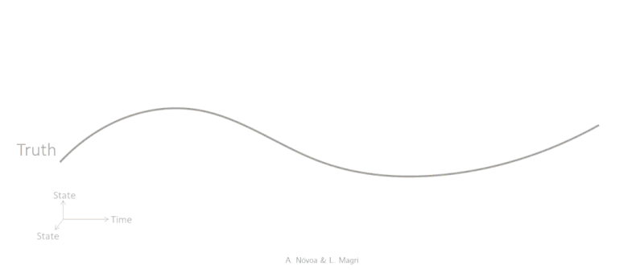

# Estimators (data assimilation)

## Summary

**Package:** `src/romda/estimators/`. The layout, the keywords and the equations mirror those of
[`biasda`](https://github.com/andreanovoa/biasda), which romda will import once it is released.

romda keeps only the filters that its papers employ: the ensemble Kalman filters of the washout-free
echo state network, of the thermoacoustic bias-aware papers and of the reduced-order-model data
assimilation, and the linear Kalman filter of the introductory tutorials.
[`biasda`](https://github.com/andreanovoa/biasda) holds the other methods: the deterministic and the
other square-root ensemble updates, the dual state-parameter scheme, covariance localization (LETKF),
the bias-estimation routes, the extended and unscented Kalman filters, the particle filters, nudging,
the smoothers and the variational methods. In romda, an option that selects one of these methods
raises `NotImplementedError`, and the message names biasda.

An estimator is classified by **what it estimates** and by **how it assimilates**.

What is estimated is a configuration of the augmented state, not a class tree:

- the state, always;
- the parameters named in `est_alpha`, which are appended to the state and updated by the same
  analysis (`parameter_estimation='joint'`);
- a bias, when a `Bias` estimator is attached (`parent_bias=` on the ensemble filters, `bias=` on
  the Kalman filter): the analysis corrects the forecast observables with the current bias estimate,
  and the bias-regularization factor, $\gamma > 0$ (`bias_regularization`), adds the bias-norm
  regularization of the regularized bias-aware EnKF (`rEnKF`). After each analysis, the bias state
  is reset to the analysis innovation.

How it assimilates:

```
Estimator  (ABC: configuration and bias machinery)
└── SequentialEstimator                 (forecast/analysis cycle)
    ├── KalmanFilter                    type = linear, parameter_estimation = None | joint
    └── EnsembleFilter                  type = stochastic | sqrt, parameter_estimation = None | joint
        ├── EnKF                        (stochastic)
        │   └── rEnKF                   (bias-aware, regularized)
        │       └── rBA_EnKF            (the name of rEnKF in Nóvoa, Racca & Magri 2023)
        └── EnSRKF                      (sqrt)
```

The shared configuration takes one spelling per option: `inflation` (the multiplicative inflation
factor) and `bias_regularization` ($\gamma$). The attribute names (`inflation_factor=`,
`regularization_factor=`) are not keywords and raise `TypeError`, as in biasda; `rEnKF` also
rejects `gamma=`, which on the other filters reaches the forecast model (the parameter `gamma` of `VdP`).

The relationship between the three main classes — attributes, not subclasses:

```
Estimator instance
  .model  →  Model instance   (used for the forecast)
  .bias   →  Bias instance    (optional; None if bias-unaware)
             .forecaster  →  Model instance   (usually an ESN_model)
```

See [Ensemble filters](filter_stochastic.md) and [Kalman filters](filter_deterministic.md)
for the concrete implementations.

<figure markdown>
  { width="700" }
  <figcaption>The real-time assimilation cycle: forecast, analysis, repeat.</figcaption>
</figure>

------

::: romda.estimators.Estimator

::: romda.estimators.SequentialEstimator
