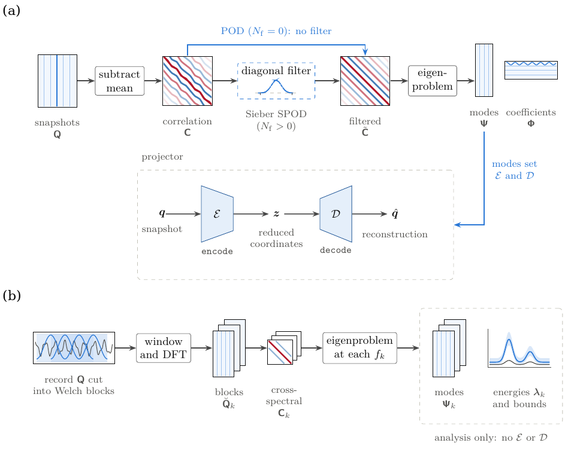
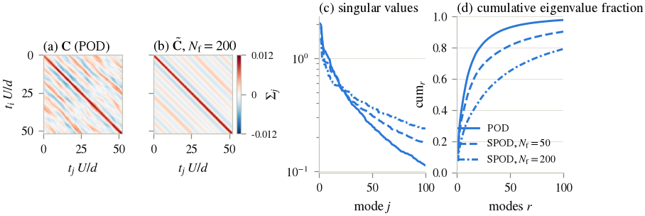
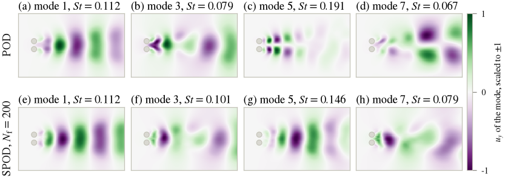
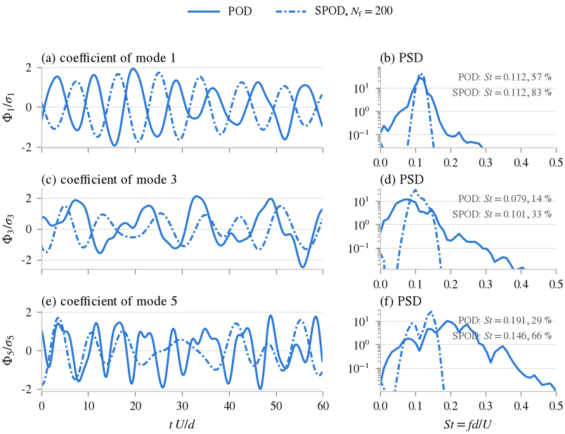
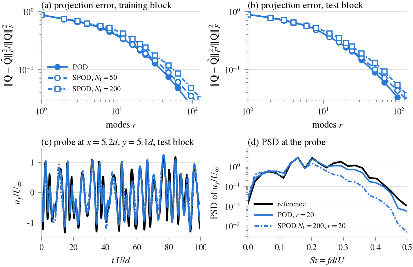
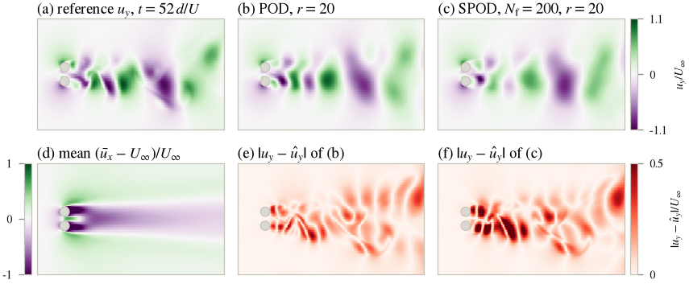
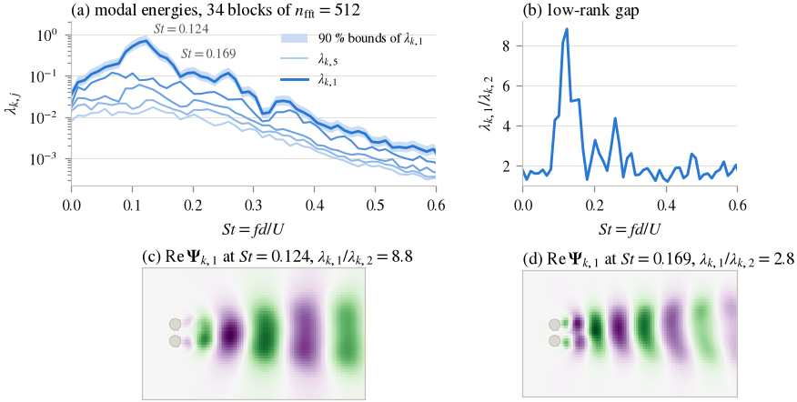

# Projectors and modal decompositions

A projector maps a flow field to a small set of reduced coordinates and back. Every projector
shares the `fit` / `encode` / `decode` interface of `Projector`, so a reduced-order model can
swap one projector for another. This page covers the linear projectors, `POD` and `SPOD`, and
the standalone decomposition functions in `pod_utils`, which include the frequency-domain SPOD.
The nonlinear projectors, the convolutional autoencoders, are on the page
[Convolutional autoencoders](convolutional_autoencoders.md).

**Files:** `src/romda/models/data_driven/autoencoders/base.py` (the interface),
`pod.py` (`POD`, `SPOD`) and `pod_utils.py` (the decomposition algorithms).

## Notation and interface

The data matrix $\matr{Q} \in \mathbb{R}^{N_x \times N_t}$ stores one snapshot, $\vect{q}$, per column, in
which $N_x$ is the number of degrees of freedom (fluid points times field components) and
$N_t$ is the number of snapshots. The zero-mean data matrix is

$$
\matr{Q}' = \matr{Q} - \bar{\matr{Q}},
$$

where $\bar{\matr{Q}} = \bar{\vect{q}}\vect{1}^\mathrm{T}$ repeats the temporal mean of the training
snapshots, $\bar{\vect{q}} \in \mathbb{R}^{N_x}$ (`Q_mean`), in every column. A linear projector stores the spatial modes,
$\matr{\Psi} \in \mathbb{R}^{N_x \times r}$ (`Psi`), the temporal coefficients,
$\matr{\Phi} \in \mathbb{R}^{r \times N_t}$ (`Phi`), and the singular values,
$\matr{\Sigma} = \mathrm{diag}(\Sigma_1, \dots, \Sigma_r)$ (`Sigma`, stored as a vector), where $r$ is the number of retained modes
(`N_latent`, also available as `N_modes` on `POD` and `SPOD`). The reduced coordinates of a set of snapshots are
$\matr{Z} = \mathrm{encode}(\matr{Q}) \in \mathbb{R}^{r \times N_t}$.

`fit` accepts a flat data matrix, shape $(N_x, N_t)$, or a grid array, shape
$(N_u, N_t, N_x, N_y)$, with NaN at solid points; for grid input the solid mask is detected
and stored. `decode` always returns the flat field with the mean restored, `decode_at`
returns selected rows only (for example, sensor locations), and `score` returns the mean
squared reconstruction error.



*The linear projectors of romda. POD and Sieber SPOD share the snapshot eigenproblem and differ by the diagonal filter of the correlation matrix; the Towne SPOD works per frequency on Welch blocks and has no encode or decode map.*


::: romda.models.data_driven.autoencoders.Projector

## Snapshot POD

The proper orthogonal decomposition (POD) finds the orthonormal basis that captures the
largest fraction of the fluctuation energy for any number of modes
[(Eckart & Young 1936)](#references). The method of snapshots
[(Sirovich 1987)](#references) obtains the basis from the small $N_t \times N_t$ temporal
correlation matrix instead of the $N_x \times N_x$ spatial one. The eigenvalue problem is

$$
\matr{C}\matr{V} = \matr{V}\,\mathrm{diag}(\vect{\lambda}),
\qquad \matr{C} = \frac{1}{N_t}\matr{Q}'^\mathrm{T}\matr{Q}',
\qquad \lambda_1 \ge \lambda_2 \ge \dots \ge 0,
$$

where $\matr{C}$ is the temporal correlation matrix, $\matr{V}$ stores its eigenvectors as
columns and $\vect{\lambda}$ its eigenvalues. The modes and coefficients are

$$
\matr{\Psi} = \matr{Q}'\matr{V}\,\mathrm{diag}(N_t\vect{\lambda})^{-1/2},
\qquad
\matr{\Phi} = \matr{\Psi}^\mathrm{T}\matr{Q}',
\qquad
\Sigma_j = \sqrt{\lambda_j},
$$

in which $\matr{\Psi}$ has orthonormal columns. Modes with $\lambda_j \le 0$ (round-off) are
set to zero. Encoding is the orthogonal projection and decoding is its inverse on the span of
the modes,

$$
\matr{Z} = \matr{\Psi}^\mathrm{T}(\matr{Q} - \bar{\matr{Q}}),
\qquad
\hat{\matr{Q}} = \matr{\Psi}\matr{Z} + \bar{\matr{Q}},
$$

where $\hat{\matr{Q}}$ is the reconstruction, which equals $\matr{Q}$ when all modes with
$\lambda_j > 0$ are retained. The energy fraction of mode $j$ is

$$
\mathrm{rel}_j = \frac{\Sigma_j^2}{\sum_{k=1}^{r} \Sigma_k^2},
\qquad
\mathrm{cum}_j = \sum_{k \le j} \mathrm{rel}_k,
$$

where the sums run over the $r$ retained modes only (`energy_fraction`), so that
$\mathrm{cum}_r = 1$ for any $r$. Both solvers truncate to `n_modes` during `fit`. For the
fraction of the total fluctuation energy, fit with `method='exact'` and `n_modes` equal to
$N_t$, or pass the full `Sigma` returned by `snapshot_pod` to `energy_fraction`, before
truncating.

**Solvers.** The option `method` selects the solver:

- `'randomized'` (default) computes a truncated randomized singular value decomposition,
  $\matr{Q}' \approx \sqrt{N_t}\,\matr{\Psi}\matr{\Sigma}\matr{V}^\mathrm{T}$, with `n_iter=4` power iterations
  (`sklearn.utils.extmath.randomized_svd`), which gives $\matr{\Psi}$ and
  $\matr{\Sigma}$, and sets $\matr{\Phi} = \matr{\Psi}^\mathrm{T}\matr{Q}'$
  [(Halko et al. 2011)](#references). The scaling matches the exact solver because
  $\matr{C} = \matr{V}\matr{\Sigma}^2\matr{V}^\mathrm{T}$. Only the leading `n_modes` modes are
  computed. The seed is `random_state`.
- `'exact'` solves the full eigenvalue problem of $\matr{C}$, whose cost scales as
  $\mathcal{O}(N_t^3)$ and memory as $\mathcal{O}(N_t^2)$, and then truncates.

The number of modes, `n_modes`, defaults to `None`, which means 20, or the number of rows of
a pre-set `Phi`. Unknown keyword arguments raise `TypeError`.

**When to use.** POD is the default linear projector: its modes are orthonormal, its
encoding is a single matrix product, and its truncation error is the smallest of any rank-$r$
linear basis. The randomized solver is suited to long records ($N_t$ in the thousands); the
exact solver is suited to short records and to computing the full energy spectrum.

```python
import numpy as np
from romda.models.data_driven.autoencoders import POD

t = np.arange(400) * 0.05
x = np.linspace(0, 1, 64)[:, None]
X = np.sin(2 * np.pi * x) * np.cos(3 * t) + 0.5 * np.cos(4 * np.pi * x) * np.sin(7 * t)

pod = POD(n_modes=4, method='exact').fit(X)    # X: (N_x, N_t)
Z = pod.encode(X)                              # reduced coordinates, (4, N_t)
X_hat = pod.decode(Z)                          # flat field with the mean restored
print(pod.score(X), pod.energy_fraction()[1])
```

::: romda.models.data_driven.autoencoders.POD

::: romda.models.data_driven.autoencoders.pod_utils.snapshot_pod

::: romda.models.data_driven.autoencoders.pod_utils.snapshot_pod_randomized

::: romda.models.data_driven.autoencoders.pod_utils.energy_fraction

## Spectral POD of Sieber et al.

The spectral POD of [Sieber et al. (2016)](#references) filters the temporal correlation
matrix along its diagonals before the eigenvalue problem. The filter favours modes whose
temporal coefficients vary on a single time scale, so that SPOD separates dynamics that POD
mixes into the same mode. The filtered correlation matrix is

$$
\tilde{C}_{ij} = \sum_{k=-N_\mathrm{f}}^{N_\mathrm{f}} w_k\, C_{i+k,\,j+k},
$$

where $N_\mathrm{f}$ is the filter half-width (`Nf`), $w_k$ is a symmetric low-pass kernel normalized
to $\sum_k w_k = 1$, and the indices $i+k$ and $j+k$ are taken modulo $N_t$, i.e. the
correlation matrix is continued periodically at the ends. The option `filter_kind` selects
the kernel: `'gaussian'` (default), $w_k \propto \exp[-k^2 / (2 (N_\mathrm{f}/2)^2)]$; `'box'`,
$w_k \propto 1$; or `'hann'`, the Hann window of length $2N_\mathrm{f} + 1$. The eigenvalue problem
$\tilde{\matr{C}}\matr{V} = \matr{V}\,\mathrm{diag}(\vect{\lambda})$ gives the temporal coefficients
and spatial modes

$$
\matr{\Phi} = \mathrm{diag}(N_t\vect{\lambda})^{1/2}\matr{V}^\mathrm{T},
\qquad
\matr{\Psi} = \matr{Q}\matr{V}\,\mathrm{diag}(N_t\vect{\lambda})^{-1/2},
\qquad
\Sigma_j = \sqrt{\lambda_j},
$$

so that $\matr{Q}' = \matr{\Psi}\matr{\Phi}$ at full rank. The rows of $\matr{\Phi}$ are
orthogonal, $\matr{\Phi}\matr{\Phi}^\mathrm{T} = N_t\,\mathrm{diag}(\vect{\lambda})$, but for
$N_\mathrm{f} > 0$ the columns of $\matr{\Psi}$ are not orthonormal. For this reason, `SPOD.encode` is
the least-squares projection

$$
\matr{Z} = \matr{\Psi}^{+}(\matr{Q} - \bar{\matr{Q}}),
$$

where $\matr{\Psi}^{+}$ is the Moore–Penrose pseudo-inverse of the retained modes. With
truncation and $N_\mathrm{f} > 0$, the coefficients that `encode` returns on the training snapshots
differ from the stored Sieber coefficients, `Phi`, because the least-squares projection
minimizes the reconstruction error and `Phi` does not.

**Limits.** The filter width interpolates between two decompositions. With `Nf=0` (default)
the filter is skipped, $\tilde{\matr{C}} = \matr{C}$, and SPOD equals snapshot POD. With the box
kernel and $N_\mathrm{f}$ close to $N_t/2$, $\tilde{\matr{C}}$ becomes circulant and the modes approach Fourier
modes.

**Options.** `Nf` (default 0), `filter_kind` (default `'gaussian'`) and `n_modes` (default
20; `None` keeps all $N_t$ modes). The solver is always the full eigenvalue problem, so the
cost is that of `POD(method='exact')`. The filtered matrix $\tilde{\matr{C}}$ is stored as `C_tilde`.

**When to use.** Sieber SPOD is suited to flows with several coherent structures at
different frequencies, such as a vortex shedding mode and a slower modulation, when the
reduced-order model needs one coefficient per structure in the time domain. Because the
filter width sets the trade-off between energy optimality and spectral purity, compare the
modes for several values of $N_\mathrm{f}$ with those of POD ($N_\mathrm{f} = 0$).



*Correlation matrices and spectra of POD and Sieber SPOD on the wake of two side-by-side cylinders ($Re = 200$, 3000 snapshots). The Gaussian filter with $N_\mathrm{f} = 200$ straightens the drifting diagonals of the correlation matrix and spreads the energy over more modes: the leading 20 POD modes hold 79 % of the fluctuation energy, and the SPOD eigenvalues decay more slowly as $N_\mathrm{f}$ grows. POD 16 s, SPOD 20 to 46 s on 8 CPU threads.*



*The $u_y$ component of modes 1, 3, 5 and 7 of POD (top) and of SPOD with $N_\mathrm{f} = 200$ (bottom), with the Strouhal number of the peak of each temporal coefficient. POD mixes the modulation of the gap flow ($St = 0.07$ to $0.08$) with the shedding of the individual cylinders ($St = 0.19$); each SPOD pair holds one Strouhal number.*



*Temporal coefficients of modes 1, 3 and 5 and their Welch spectra for POD (solid) and SPOD with $N_\mathrm{f} = 200$ (dash-dotted). The filter narrows the spectrum of every coefficient: the fraction of the power within 10 % of the peak rises from 57 to 83 % (mode 1), from 14 to 33 % (mode 3) and from 29 to 66 % (mode 5).*



*Relative squared projection error against the number of modes on the training and test blocks, and the $u_y$ signal and spectrum at the probe of largest variance with 20 modes. POD has the smallest error at every $r$ (0.24 on the test block with 20 modes, against 0.25 for $N_\mathrm{f} = 50$ and 0.29 for $N_\mathrm{f} = 200$); SPOD loses the power above $St \approx 0.25$ that its 20 modes do not hold.*



*A test snapshot reconstructed with 20 modes: reference, POD and SPOD ($N_\mathrm{f} = 200$) on one colour scale, the training mean, and the absolute errors from zero to half the reference amplitude. The relative squared error is 0.12 for POD and 0.25 for SPOD; both smooth the small vortices downstream of $x \approx 10\,d$.*


::: romda.models.data_driven.autoencoders.SPOD

::: romda.models.data_driven.autoencoders.pod_utils.spod_sieber

## Frequency-domain SPOD of Towne et al.

The frequency-domain SPOD of [Towne et al. (2018)](#references) computes, at each frequency,
the modes that are optimal in energy for a statistically stationary flow. The modes
are the eigenvectors of the cross-spectral density matrix, which `spod_towne` estimates with
Welch's method [(Welch 1967)](#references): it splits the record into $n_\mathrm{blk}$
overlapping blocks of length $n_\mathrm{fft}$ (`n_fft`) with overlap $n_\mathrm{ovlp}$
(`n_ovlp`), windows each block, and Fourier transforms it. Block $b$ starts at snapshot
$b\,(n_\mathrm{fft} - n_\mathrm{ovlp})$, and its discrete Fourier transform at frequency
$f_k = k / (n_\mathrm{fft}\,\Delta t)$ is

$$
\breve{\vect{q}}^{(b)}_k = \frac{1}{n_\mathrm{fft}\,\bar{w}}
\sum_{t=0}^{n_\mathrm{fft}-1} w_t\,\vect{q}^{(b)}_t\,
e^{-\mathrm{i}2\pi kt/n_\mathrm{fft}},
$$

where $\vect{q}^{(b)}_t$ is the $t$-th snapshot of the block, $w_t$ is the window (`window`),
$\bar{w}$ is its mean and $\Delta t$ is the time step (`dt`). For real data only the
$n_\mathrm{fft}/2 + 1$ non-negative frequencies are kept. Stacking the blocks in
$\breve{\matr{Q}}_k \in \mathbb{C}^{N_x \times n_\mathrm{blk}}$, the method of snapshots at each
frequency solves

$$
\matr{C}_k \matr{V}_k = \matr{V}_k\,\mathrm{diag}(\vect{\lambda}_k),
\qquad
\matr{C}_k = \frac{1}{n_\mathrm{blk}}\,\breve{\matr{Q}}_k^\mathrm{H}\matr{W}_x\breve{\matr{Q}}_k,
\qquad
\matr{\Psi}_k = \frac{1}{\sqrt{n_\mathrm{blk}}}\,
\breve{\matr{Q}}_k\matr{V}_k\,\mathrm{diag}(\vect{\lambda}_k)^{-1/2},
$$

where $\matr{W}_x = \mathrm{diag}(\vect{w}_x)$ holds the spatial quadrature weights (`weight`,
uniform by default), $\matr{V}_k$ stores the eigenvectors and $\matr{\Psi}_k$ the SPOD
modes, which are orthonormal in the weighted inner product,
$\matr{\Psi}_k^\mathrm{H}\matr{W}_x\matr{\Psi}_k = \matr{I}$. The modal energies (`L`) are
the eigenvalues, $\vect{\lambda}_k$, doubled at the interior frequencies of real data to account for
the negative frequencies; below, $\vect{\lambda}_k$ denotes these doubled values, which are energies per frequency bin, not densities per unit
frequency.

**Confidence bounds.** The ratio of the estimated to the exact modal energy, multiplied by
$2n_\mathrm{blk}$, follows approximately a chi-squared distribution with $2n_\mathrm{blk}$
degrees of freedom [(Schmidt & Colonius 2020)](#references). The bounds `Lc` are

$$
\vect{\lambda}^\mathrm{lower}_k = \frac{2 n_\mathrm{blk}\,\vect{\lambda}_k}{\chi^2_{2n_\mathrm{blk}}(c)},
\qquad
\vect{\lambda}^\mathrm{upper}_k = \frac{2 n_\mathrm{blk}\,\vect{\lambda}_k}{\chi^2_{2n_\mathrm{blk}}(1-c)},
$$

where $\chi^2_{\nu}(c)$ is the $c$-quantile of the chi-squared distribution with $\nu$
degrees of freedom and $c$ is `conf_level` (default 0.95). The two bounds together form a
two-sided interval with coverage $2c - 1$, i.e. 90% for the default. The bounds narrow as
$n_\mathrm{blk}$ grows, which sets the trade-off between frequency resolution
($n_\mathrm{fft}$) and statistical convergence ($n_\mathrm{blk}$).

**Options.** `dt` (default 1.0), `n_fft` (default $2^{\lfloor \log_2(N_t/10) \rfloor}$),
`n_ovlp` (default `n_fft // 2`), `window` (default `'hamming'`, or an array of length
`n_fft`), `weight` and `conf_level`. At least two blocks are required. The function expects
zero-mean data and does not subtract the mean. It returns `L`, shape
$(n_\mathrm{freq}, n_\mathrm{blk})$, the complex modes `Psi`, shape
$(n_\mathrm{freq}, N_x, n_\mathrm{blk})$, the frequencies `f`, the bounds `Lc`, shape
$(n_\mathrm{freq}, n_\mathrm{blk}, 2)$, and an `info` dictionary, which
`print_spod_towne_summary` prints.

**When to use.** Towne SPOD is an analysis tool for statistically stationary flows: it
identifies the coherent structures at each frequency and the low-rank behaviour of the
spectrum (the gap between $\lambda_{k,1}$ and $\lambda_{k,2}$). It is not a projector, because its modes
are complex and defined per frequency, so it has no `encode` or `decode`. For a time-domain
reduced-order model, use `POD` or `SPOD`.



*Towne SPOD of the two-cylinder wake (9001 snapshots, 34 Welch blocks of 512). Modal energies with the 90 % confidence interval of $\lambda_{k,1}$, the ratio $\lambda_{k,1}/\lambda_{k,2}$, and the leading mode at the two peaks: the vortex street of the merged wake at $St = 0.124$ is low rank ($\lambda_{k,1}/\lambda_{k,2} = 8.8$), the shedding of the individual cylinders at $St = 0.169$ is not (2.8). 15 s on 8 CPU threads.*


::: romda.models.data_driven.autoencoders.pod_utils.spod_towne

::: romda.models.data_driven.autoencoders.pod_utils.print_spod_towne_summary

## References

- Eckart, C. & Young, G. 1936 The approximation of one matrix by another of lower rank.
  *Psychometrika* **1** (3), 211–218. [doi:10.1007/BF02288367](https://doi.org/10.1007/BF02288367)
- Halko, N., Martinsson, P. G. & Tropp, J. A. 2011 Finding structure with randomness:
  probabilistic algorithms for constructing approximate matrix decompositions. *SIAM Rev.*
  **53** (2), 217–288. [doi:10.1137/090771806](https://doi.org/10.1137/090771806)
- Schmidt, O. T. & Colonius, T. 2020 Guide to spectral proper orthogonal decomposition.
  *AIAA J.* **58** (3), 1023–1033. [doi:10.2514/1.J058809](https://doi.org/10.2514/1.J058809)
- Sieber, M., Paschereit, C. O. & Oberleithner, K. 2016 Spectral proper orthogonal
  decomposition. *J. Fluid Mech.* **792**, 798–828.
  [doi:10.1017/jfm.2016.103](https://doi.org/10.1017/jfm.2016.103),
  [arXiv:1508.04642](https://arxiv.org/abs/1508.04642)
- Sirovich, L. 1987 Turbulence and the dynamics of coherent structures. I. Coherent
  structures. *Q. Appl. Math.* **45** (3), 561–571.
  [doi:10.1090/qam/910462](https://doi.org/10.1090/qam/910462)
- Towne, A., Schmidt, O. T. & Colonius, T. 2018 Spectral proper orthogonal decomposition and
  its relationship to dynamic mode decomposition and resolvent analysis. *J. Fluid Mech.*
  **847**, 821–867. [doi:10.1017/jfm.2018.283](https://doi.org/10.1017/jfm.2018.283),
  [arXiv:1708.04393](https://arxiv.org/abs/1708.04393)
- Welch, P. D. 1967 The use of fast Fourier transform for the estimation of power spectra: a
  method based on time averaging over short, modified periodograms. *IEEE Trans. Audio
  Electroacoust.* **15** (2), 70–73.
  [doi:10.1109/TAU.1967.1161901](https://doi.org/10.1109/TAU.1967.1161901)
