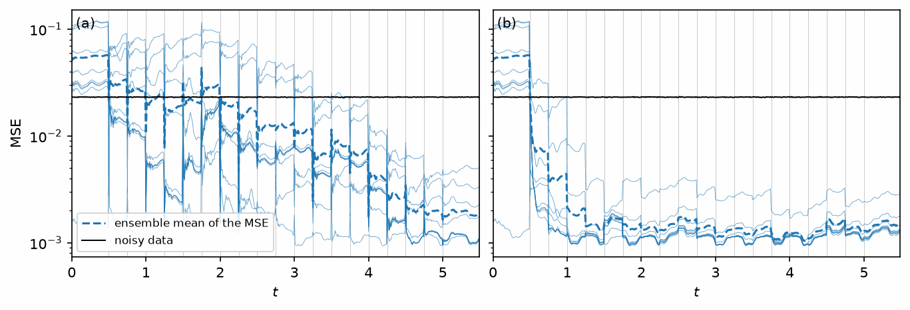
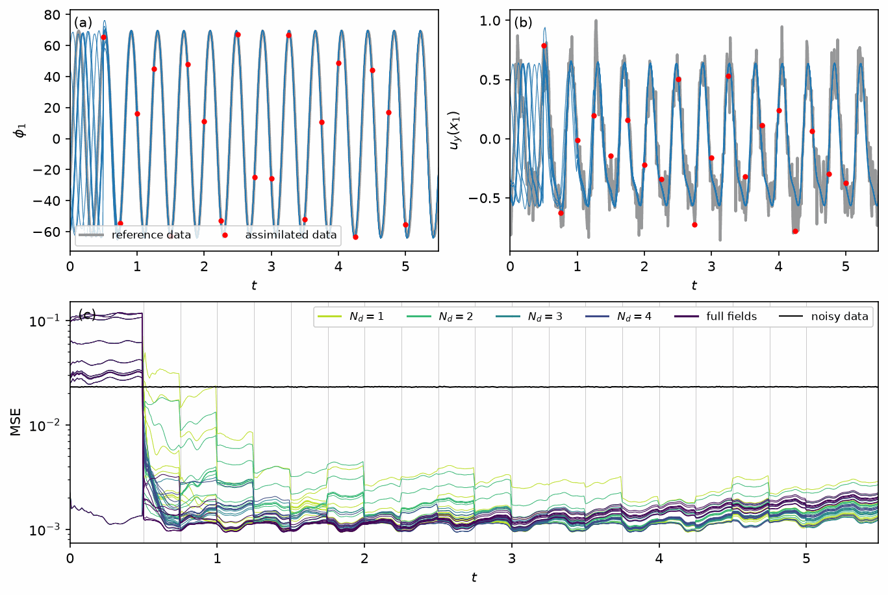
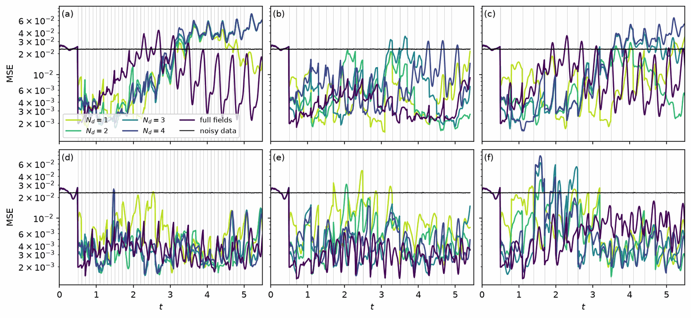

# Online learning of a POD-ESN of the cylinder wake

This page replicates Figs. 3–5 of Nóvoa & Magri (2025), *Online model learning with data-assimilated reservoir
computers*, ICCS 2025 ([doi:10.1007/978-3-031-97567-7_5](https://doi.org/10.1007/978-3-031-97567-7_5),
[arXiv:2504.16767](https://arxiv.org/abs/2504.16767)), with the current code. The code of the paper is the release
[v1.1](https://github.com/andreanovoa/romda/releases/tag/v1.1).

The conclusions of the paper hold. First, the two-fold estimation converges within four observations of one
sensor. Second, only the three-fold estimation keeps a network trained on 90 snapshots below the error of the
noisy data in every case. The curves do not match the paper digit for digit, because the random matrices of the
network, the realization of the noise and the initial ensemble differ from v1.1.

## Set-up

A POD-ESN forecasts the wake of a cylinder at a Reynolds number of 100: an echo state network propagates the
coefficients of four POD modes. An ensemble square-root Kalman filter (EnSRKF) assimilates noisy velocity
measurements into the model. Three estimation problems are compared:

- **state estimation**, in which the analysis updates the POD coefficients;
- **two-fold estimation**, which also updates the reservoir state;
- **three-fold estimation**, which also updates the singular values of the output weights, `Wout`.

The error is the mean squared error (MSE) of the reconstructed velocity with respect to the noise-free fields. The
MSE of the noisy data is $2.3 \times 10^{-2}$.

| Setting | Value | Source |
|---|---|---|
| Noise of the snapshots | Gaussian, standard deviation 0.1 of the maximum velocity, kernel of standard deviation 0.1 | paper, v1.1 |
| POD modes, reservoir size | 4, 40 | paper |
| Training snapshots | 250 (Figs. 3–4), 90 (Fig. 5) | paper |
| Spectral radius, input scaling | 0.976, 0.890 | paper |
| Ensemble size | 10 (Figs. 3–4), 50 (Fig. 5) | paper; v1.1 for Fig. 4 |
| Observation error, prior of the singular values of `Wout` | 0.01, 0.1 | v1.1 |

The spectral radius and the input scaling are fixed to the values of the paper, and only the Tikhonov factor is
searched. This is because the hyperparameter search of the current code ends on the lower bounds of the ranges of
the paper (0.2 and 0.5).

## Results

### State estimation against two-fold estimation

With one sensor, the two-fold estimation reaches an MSE of approximately $1.5 \times 10^{-3}$ within four
observations. The state estimation needs approximately eight observations to stay below the noisy data, because
the analysis does not correct the reservoir state.



*Figure 3. MSE of the ten ensemble members with one sensor: (a) state estimation and (b) two-fold estimation.
Vertical lines mark the observations.*

### Number of sensors

The full fields converge at the first observation, and every case ends with an MSE between $1.4 \times 10^{-3}$ and
$1.9 \times 10^{-3}$. One sensor placed by QR pivoting is therefore sufficient for the periodic wake.



*Figure 4. Two-fold estimation. (a) First POD coefficient when the full fields are observed, and (b) vertical
velocity at the sensor when one sensor is observed (thin lines: ensemble members). (c) MSE of the ensemble members
for one to four sensors, $N_d$, and for the full fields.*

### Network trained on a truncated record

With 90 training snapshots, the two-fold estimation ends above the noisy data in 4 of 15 cases (maximum MSE
$5.3 \times 10^{-2}$), whereas the three-fold estimation does so in none (maximum $8.1 \times 10^{-3}$). The
online update of the output weights compensates for the short training record.



*Figure 5. MSE of the ensemble mean with the network trained on 90 snapshots: (a–c) two-fold and (d–f) three-fold
estimation, for 10, 20 and 30 time steps between observations (left to right).*

## Run it

```bash
python scripts/podesn_cylinder/iccs2025.py --save-figs
```

The settings are in `scripts/podesn_cylinder/iccs2025.yml`. The 37 runs are stored in
`scripts/podesn_cylinder/results/iccs2025/`, so the figures are redrawn without filtering again; `--rerun` filters
again. The [README of the topic](https://github.com/andreanovoa/romda/tree/main/scripts/podesn_cylinder) lists
every setting with its source.
